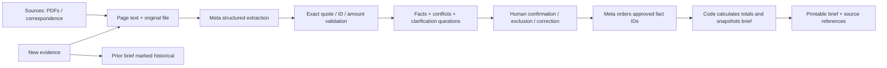

# Architecture and integrity boundaries

The hosted route permits synthetic fixture creation only. Local uploads remove fixture eligibility, preventing a fixture from masquerading as analysis of arbitrary documents. The server owns the Meta credential. No model tools or external browsing are enabled. Source text appears only in the data message, with instructions to ignore embedded commands. Responses use JSON Schema; application validation independently checks citation provenance and references.

A case carries a monotonically increasing revision and the revision last analyzed. Adding sources invalidates analysis. Reviewing current facts or supplying an answer increments the case revision while keeping extraction current. Each brief records the precise revision it represents. Changed evidence, reviews, or clarifications make older briefs historical. SQLite writes compare the expected revision, preventing a slow model response from overwriting newer work.

Original document claims remain separate from user corrections. Corrections survive subsequent analysis; unmatched corrections are retained with a duplicate-review warning. Generated briefs render stored reviewed fact text, not model-written factual prose. The model can order approved IDs and suggest consultation questions, but cannot silently add factual claims to the brief.

The balance is reviewed contract total minus reviewed payment facts. Invoices are not payments. Missing or conflicting contract totals, pending monetary facts, and potentially duplicated payments make the balance unresolved. These numbers describe the supplied records, not a debt adjudication.

Session IDs use random 256-bit cookies with HttpOnly and SameSite Strict; hosted mode requires HTTPS cookies. All mutations require a custom header and no cross-origin API access is configured. Inputs and case counts are bounded. Model execution is limited to two concurrent requests and a persisted daily attempt budget (default 100). The budget counts requests, not dollars; configure provider billing controls separately.

Local data uses OS filesystem protections; it is not encrypted by the application. Hosted mode expires cases after 24 hours and accepts no user documents. For actual multi-user client records, authentication, encryption, consent, retention controls, malware scanning, robust OCR, and an independent security review would be separate work.
